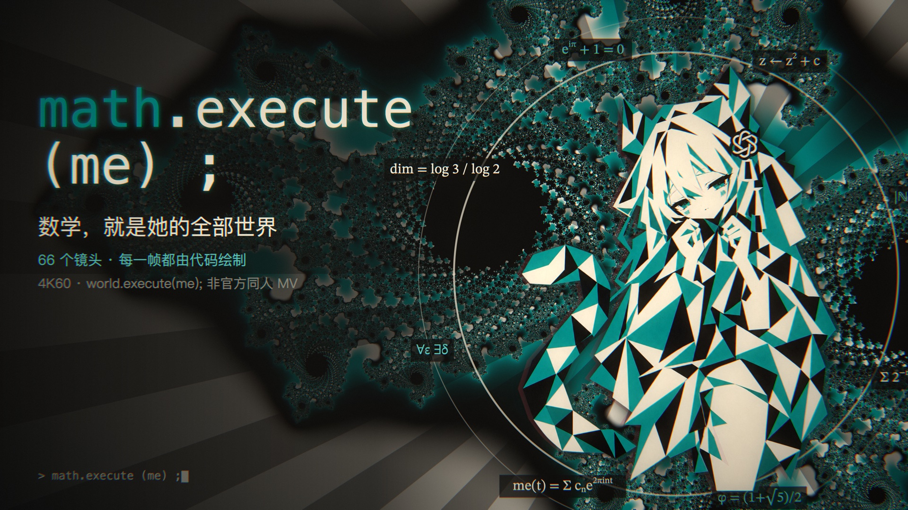

# math.execute (me) ; —— 非官方同人 MV

**在线观看：** https://408.bemly.moe/mv/ （浏览器实时渲染）

> 原曲 Mili — world.execute (me) ; 受版权保护，**未随网页发布**。打开页面后选择你本地的音频文件即可同步播放，也可以无声观看。



数学，就是她的全部世界。66 个镜头按 130 BPM 节拍网格踩点：从空集构造自然数，到质数、黄金螺线、门格海绵、超立方体、康托尔对角线、分形、傅里叶本轮，最后 `return QED ;`。

## 文件
| 文件 | 作用 |
|---|---|
| `index.html` `player.js` | 网页播放器 |
| `engine.js` | 引擎：节拍网格、WebGL 着色器背景（Julia/曼德博/门格海绵/牛顿分形/沃罗诺伊…）与后期 |
| `lib.js` | 角色特效、数学图形、动态字幕 |
| `shots1–4.js` | 66 个镜头 |
| `girl.png` `lowpoly.json` `outline.json` | 角色立绘、低多边形三角剖分、轮廓傅里叶系数 |
| `features.json` | 音频能量 / 节拍特征（逐帧） |
| `出处.srt` | 每个镜头引用的论文与 openai/math 结果族 |
| `标题与简介.txt` `cover.js` | 发布用标题、简介与封面生成 |

## 本地渲染 4K60
```bash
npm i && npx playwright install chromium
node render4k.mjs --w 3840 --h 2160 --workers 2 --chunk 300 --dir out/k4   # 可断点续渲
```
然后 concat `out/k4/*.mp4` 并配上原曲。

原曲：Mili — world.execute(me);（作曲 Mili / Cassie Wei，作词 Mili），版权归 Project Mili 及相关权利人所有。本片为非盈利同人创作，与 Mili、Anthropic、OpenAI 均无关联。
