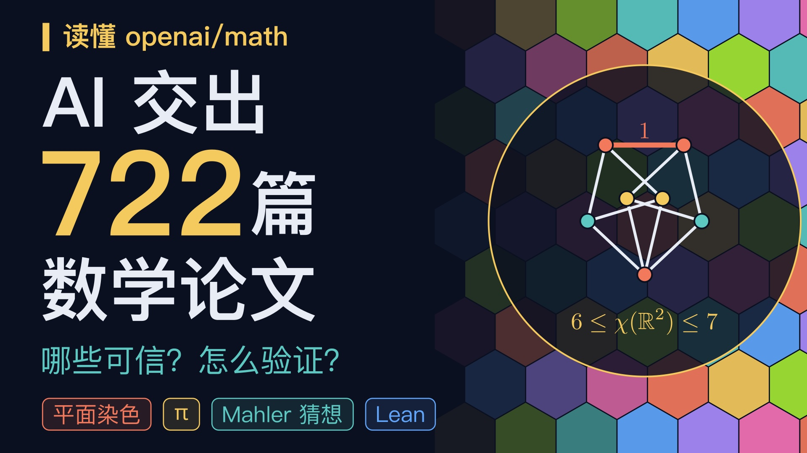

# 读懂 openai/math —— 讲解视频

**在线观看：** https://bili.bemly.moe/openai-math/ （浏览器实时渲染，配音与配乐随页面加载）

约 13 分 46 秒的中文科普：2026-10-06 OpenAI 公开的数学稿件仓库 [openai/math](https://github.com/openai/math) 是什么、怎样用 Lean 验证，以及平面染色、π 的无理性指数、Mahler 猜想三段数学。



## 做法
- 每一帧都是 `renderTime(t)` 的纯函数（Canvas 2D + WebGL 后期），无剪辑软件、无视频素材。
- 10 个章节是同一个“世界”里的站点，摄像机在章节间连续飞行，全片没有硬切。
- 解说稿 `script.py` 的每条事实都有出处，见 `SOURCES.md`。

## 文件
| 文件 | 作用 |
|---|---|
| `index.html` `player.js` | 网页播放器（以音频时钟驱动实时渲染） |
| `engine.js` `lib.js` | 渲染引擎与通用图形（与 `../math-execute-me` 同源） |
| `stage.js` | 世界摄像机、章节间飞行、字幕 |
| `ch_a.js` `ch_b.js` `ch_c.js` | 第 0–3 / 4–6 / 7–9 章画面 |
| `script.py` `SOURCES.md` | 解说稿与事实核对表 |
| `audio/` `timeline.json` | 逐句配音（edge-tts）与时间轴 |
| `mix.mp3` | 配音 + 程序化配乐的混音（网页用） |
| `字幕.srt` | 外挂字幕 |

## 本地渲染成片
```bash
npm i && npx playwright install chromium
pip install edge-tts numpy scipy          # 仅在重新生成配音 / 配乐时需要
python tts.py && python make_timeline.py  # 改了解说稿时
python mix.py                             # 生成 mix.wav（配音 + 配乐，-16 LUFS）
node still.mjs review.png 30 120 400      # 检查若干时间点的静帧
node render4k.mjs --w 1920 --h 1080 --workers 3 --dir out/hd --n 49555   # 可断点续渲
```
最后用 ffmpeg 把 `out/hd/*.mp4` concat 并配上 `mix.wav`。
